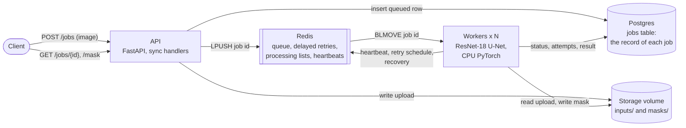

# SurgiServe

An inference service for the instrument-segmentation model in
[surgiseg-ml](https://github.com/mghadia1/surgiseg-ml): upload a
gastrointestinal endoscopy frame, get back a mask of the instruments in it.

The point of the project is the service around the model: an API, a job
queue, a database, workers, failure handling and load testing.

> **What this is not:** a medical device or clinical tool. The model is an
> educational benchmark on one public research dataset (Kvasir-Instrument),
> which is licensed for research and educational use only.
> **Do not upload real patient images.**

## Status

| # | Milestone | Status |
|---|-----------|--------|
| 0 | Skeleton: tooling, CI, `/health`, Compose with only the API | Done |
| 1 | Postgres and Alembic, `POST /jobs`, `GET /jobs/{id}`, input validation | Done |
| 2 | Redis queue and a worker running a fake model, end to end | Done |
| 3 | Real inference with the surgiseg-ml checkpoint, masks and result links | Done |
| 4 | Retries with backoff, timeouts, dead-letter queue, worker crash recovery | Done |
| 5 | Structured JSON logs and a deep `/health` check | Done |
| 6 | Locust load test with 1, 2 and 4 workers | Measured (see Load testing); waiting on CI |
| 7 | Architecture diagram, design decisions, benchmarks | Written; waiting on CI |

The worker runs the real network: the frozen ResNet-18 U-Net from
surgiseg-ml (run of 2026-08-03, Dice 0.9226 on Kvasir-Instrument's 118-image
official test split, scored at 128x128). A fake brightness-threshold model
remains for running without weights.

## Quickstart

Needs Docker, and the frozen weights in `weights/` (see [The model](#the-model)).

```bash
make weights                   # copy them from ../surgiseg-ml
docker compose up --build --detach --wait
curl http://localhost:8000/health
docker compose down            # keeps the database and uploads
docker compose down --volumes  # deletes them
```

Compose starts Postgres and Redis, then a one-shot `migrate` service that
runs `alembic upgrade head` and exits, then the API and one worker, which both
wait for the migration to succeed. Postgres is published on `127.0.0.1:5433`
and Redis on `127.0.0.1:6380`, with development-only credentials. Redis keeps
an append-only file, so queued ids survive a Redis restart.

More workers:

```bash
docker compose up --detach --wait --scale worker=3
```

Interactive API docs are at <http://localhost:8000/docs> while it runs.

One Dockerfile builds two images: `api` (348 MB, also used by the migrate
step) and `worker` (1.4 GB, almost all of it CPU-only PyTorch). The API never
imports the model, so its image leaves PyTorch out; CI checks that it stays
out. The first worker build downloads PyTorch; later builds reuse the layer.

## Architecture



Three stores, each with one job:

- **Postgres** is the record: what each job is, its status, attempts, error
  and result. Every status change is a conditional `UPDATE`.
- **Redis** only moves ids around: who should work on what next, who is
  holding what, and who is still alive. Losing a Redis entry can delay a job
  (a sweep puts it back); it cannot change what the job is.
- **The storage volume** holds the images, named by job id, written
  atomically.

| Redis key | Type | Holds |
|-----------|------|-------|
| `surgiserve:queue` | list | job ids waiting for a worker |
| `surgiserve:processing:<worker id>` | list | the id a worker has claimed |
| `surgiserve:delayed` | sorted set | ids waiting to be retried, scored by when |
| `surgiserve:worker:<worker id>` | string with TTL | a worker's heartbeat and the model it runs |

## How a job flows

1. `POST /jobs` validates and stores the image, inserts a `queued` row in
   Postgres, then pushes the job id onto a Redis list.
2. A worker claims the id with `BLMOVE`, which atomically moves it from the
   queue to that worker's own processing list.
3. The worker flips the row from `queued` to `running` and counts the
   attempt, with a conditional `UPDATE … WHERE status = 'queued'`. If no row
   changes (the job is already done, or the id was delivered twice) it skips
   the job.
4. It runs the model (loaded once at start-up) under a time limit, writes the
   mask to `masks/<job id>.png`, and records the outcome (below).
5. Only then does it remove the id from its processing list.

The queue carries only ids; Postgres is the record of each job. The queue is
written by hand in `src/surgiserve/job_queue.py` rather than using Celery or
RQ, so every step and every failure path is visible code.

## When things go wrong

```
queued -> running -> succeeded
                  -> failed          input missing or unreadable: retrying can't help
                  -> queued          model error or timeout: retry after a backoff
                  -> dead_lettered   out of attempts (3 by default)
```

| Failure | What happens |
|---------|--------------|
| Model raises, or an attempt runs past the timeout (30 s) | Back to `queued`; the id waits in a Redis sorted set for 2 s, 4 s, … (capped at 60 s, randomly scaled by 0.5-1 so retries do not arrive in step), then returns to the queue |
| The same, on the last attempt | `dead_lettered`, with the last error |
| Stored input missing or unreadable | `failed` at once; no retry |
| Worker killed mid-job | Its heartbeat key (TTL 15 s) expires; another worker resets the job to `queued` and puts the id back on the queue |
| A job that keeps killing its worker | When its worker dies on its last allowed attempt, it is dead-lettered instead of requeued (a crash counts as an attempt) |
| A worker presumed dead wakes up and finishes | Its result is discarded: every final update matches on the attempt number, which a newer attempt has changed |
| Redis down when a job is submitted | Row and file removed, `503`, client retries |
| A job left `queued` with its id in no queue (a process died between a database write and the Redis step) | After 5 minutes the sweep re-enqueues it |
| Database or Redis down while a worker holds a job | The id stays on that worker's processing list; the worker's next maintenance pass, between jobs, puts it back on the queue |
| Worker sent SIGTERM (`docker compose stop`) | Finishes the current job, then exits |

Every worker runs the maintenance pass (promote due retries, recover dead
workers' jobs, sweep stranded ones) every 5 s. It is safe with many workers:
each Redis step is one atomic command or Lua script, and each database change
is a conditional `UPDATE`, so whoever gets there first does the work.

Dead-lettered jobs stay in Postgres (`status = 'dead_lettered'`) rather than
in a second Redis list, so there is one record of them, not two to keep in
step. An operator command lists and requeues them; it is not an HTTP route,
because the API has no authentication:

```bash
docker compose exec worker python -m surgiserve.admin dead-letters
docker compose exec worker python -m surgiserve.admin requeue <job id> …
```

Checked live against the Compose stack, not only in tests: a worker
SIGKILLed mid-job had its job recovered and finished by the other worker; a
killed and immediately restarted worker had its job recovered (see below);
a job whose attempts all timed out retried twice with backoff, was
dead-lettered, then requeued with the command above and succeeded.

**A bug the kill test found.** Worker ids were `hostname-pid`. In a container
the pid is always 1, so a worker that crashed and was restarted by Docker came
back with the dead worker's id. Its fresh heartbeat made the dead worker look
alive, and the job it held stayed `running` indefinitely. Ids now carry a
random suffix per process start.

Known limits:

- The timeout uses `SIGALRM`, which Python handles between bytecodes. The
  model's many short native calls leave room for it, but a single native call
  that never returned would not be interrupted; running the model in a child
  process would cover that.
- A retry starts up to one maintenance interval (5 s) after its backoff ends,
  since that is when due retries are promoted.
- The stranded-job sweep checks each candidate with `LPOS`, which scans the
  queue: fine for a handful of candidates, not for a very long backlog.

## The model

- **Code:** the network and its config class are imported from surgiseg-ml,
  installed at a pinned commit, not copied. `src/surgiserve/surgiseg_model.py`
  adds only the inference path around it: RGB / 255, stretch to 128x128
  (bilinear), sigmoid, average with the horizontally flipped prediction,
  resize the probabilities back to the upload's size, threshold at `>= 0.47`.
- **Weights:** the frozen checkpoint (57 MB) is not in this repository. The
  worker reads it from `weights/`, mounted read-only, and refuses to start
  unless the checkpoint and its config hash to the SHA-256 values recorded by
  the benchmark.
- **Reproduces the benchmark exactly:** on all 118 official test images, this
  service's probabilities are bit-identical to the ones the frozen benchmark
  scored (maximum difference 0.0; no mask pixel differs at 0.47). A test
  checks 6 of them wherever the weights and data exist.
- **Two traps, both tested:**
  - ImageNet normalisation happens inside the network only if it is built
    with `normalize_for_imagenet=True`. A network built by hand with defaults
    loads the same weights without error and gives wrong masks. The service
    builds it with surgiseg-ml's `build_model`, and a golden test compares the
    whole path with surgiseg-ml's own `_predict_probabilities`.
  - The run's `config.json` says `threshold: 0.5`; that is the training
    default. The benchmark was scored at 0.47, which is what the service uses.
- **Masks at full size are this service's step.** The benchmark scored masks
  at 128x128. Resizing back to the upload's size is not part of what it
  measured, so full-size masks may score a little differently (on one test
  frame: 0.9833 at 128x128, 0.9776 at 768x576).
- **Not clinical:** see the note at the top.

To run with the real weights, copy them from a local surgiseg-ml checkout
(`make weights`, which reads `SURGISEG_RUN_DIR`). `SURGISERVE_MODEL=fake`
runs without them; with `SURGISERVE_FAKE_MODEL_DELAY_SECONDS`,
`SURGISERVE_JOB_TIMEOUT_SECONDS` and `SURGISERVE_MAX_ATTEMPTS` it is how the
failure paths above were exercised.

## Health and logs

**Two health checks, on purpose.** `/health` is liveness: the process is up.
It touches nothing else, because Docker restarts a container whose liveness
check fails, and restarting the API would not fix a database outage.
`/health/ready` is readiness, for deciding whether to send this instance
traffic. It checks each dependency with a short timeout and answers `503` if
any fails:

| Check | Passes when |
|-------|-------------|
| `database` | Postgres answers a query |
| `schema` | the database is migrated to the revision the code needs (a test keeps that constant equal to the newest migration) |
| `redis` | Redis answers `PING` |
| `storage` | a file can be written to the storage directory and removed |

It also reports, without changing the status code, the live workers and the
model each runs (read from their heartbeats), queue depths and the number of
dead-lettered jobs. No live worker is a warning: the API can still accept
jobs, which wait in the queue.

```json
{"status": "ok", "checks": {"database": {"ok": true, "ms": 1.2}, "schema": {"ok": true, "detail": "at 0003"}, …},
 "workers": {"alive": 1, "models": {"surgiseg-resnet18-unet@5c2308207401": 1}},
 "queue": {"waiting": 0, "delayed": 0, "processing": 0, "dead_lettered": 0}, "warnings": []}
```

Checked live: with Redis stopped, then Postgres stopped, readiness answered
`503` naming the failed dependency (in 0.1 s, not a hang) while liveness
stayed `200`; both returned to `200` when the service came back.

The worker container has its own health check: its main loop touches a file
on every pass, and the check fails if the file is more than 60 s old. That
shows the loop itself is turning, which the Redis heartbeat (sent from a
separate thread) does not.

**Logs** are one JSON object per line, from both services, uvicorn's own
messages included (the one-shot `migrate` step still logs Alembic's plain
text). Every line has `ts`, `level`, `service`, `logger`, `event` and
`message`. Context is attached automatically: every line logged while
handling a request carries its `request_id` (also returned to the client as
`X-Request-ID`, or taken from the request if it sends a plain one), and every
line logged while running a job carries `worker_id`, `job_id` and `attempt`.
So one job can be followed through both services:

```bash
docker compose logs --no-log-prefix api worker | grep <job id>
```

```json
{"service": "api", "event": "job.created", "request_id": "demo-req-1", "job_id": "7ec7d6e1-…", …}
{"service": "worker", "event": "job.started", "worker_id": "08898e3b9c6e-1-baa882cb", "attempt": 1, "job_id": "7ec7d6e1-…", …}
{"service": "worker", "event": "job.succeeded", "attempt": 1, "duration_ms": 308.7, "job_id": "7ec7d6e1-…", …}
```

Requests to `/health*` are logged at DEBUG, since Docker polls them.
`SURGISERVE_LOG_FORMAT=text` gives plain lines for local reading.

## Load testing

**Result:** on one 8-core laptop, scaling comes from adding workers at one
PyTorch thread each, not from PyTorch's threads. Four single-thread workers
completed **12.4 jobs/s**, 2.8x the 4.4 jobs/s of four workers at PyTorch's
default, which is no faster than one worker.

| Workers | PyTorch default (8 threads each) | 1 thread each | Even split (8 / workers) |
|---|---|---|---|
| 1 | 4.50 jobs/s (208 ms) | 5.28 jobs/s (181 ms) | — |
| 2 | 3.96 jobs/s (462 ms) | 8.87 jobs/s (215 ms) | 8.06 jobs/s (222 ms) |
| 4 | 4.36 jobs/s (853 ms) | **12.41 jobs/s (299 ms)** | 11.60 jobs/s (310 ms) |

Jobs completed per second, mean of two runs, with the median time a job spent
in the worker (decode, model with flip TTA, resize, PNG, write) in brackets.
Raw data: `bench/results/20261001T031405Z/`.

What the numbers say:

- **At the default, more workers do not help.** Throughput stays near 4-4.5
  jobs/s while each job's processing time climbs from 208 to 462 to 853 ms:
  8, 16, then 32 compute threads competing for 8 CPUs.
- **At one thread per worker, workers scale:** 1.7x with 2, 2.35x with 4.
  Not linear: processing time still rises from 181 to 299 ms. The likely
  reasons, not separated here, are that half of the M2's cores are efficiency
  cores, and that the API, Postgres, Redis and the load generator share the
  same 8 CPUs.
- **Even for one worker, one thread is better:** a little more throughput
  (5.28 vs 4.50) for under a quarter of the CPU (100% vs about 460% in
  `docker stats`). Likely because the model's input is small (128x128), so
  splitting each operation across 8 threads costs more than it saves; that
  explanation was not tested separately.
- Compose therefore defaults to `SURGISERVE_TORCH_THREADS=1`.

**How it was measured.** `bench/run.py` drives a closed-loop Locust load
(`bench/locustfile.py`): 16 users, each uploading the same real 768x576
Kvasir-Instrument test frame, waiting for its job, then uploading the next.
Every configuration starts from empty volumes, warms up for 15 s and is
measured for 60 s. Throughput and processing time come from the job
timestamps in Postgres, not from Locust's polling. Each configuration ran
twice, in a forward and then a reverse pass with 30 s cool-downs, so that a
steady slowdown (a fanless laptop warming up) affects each configuration's
mean about equally.

- **Quality of the run:** 16 of 16 runs valid (the host read back at most 46
  MB from swap during any run); 0 failed jobs among the 7,083 measured (9,233
  submitted, counting warm-ups) and 0 failed requests among 165,416. The two
  runs of each configuration agree within 7%, except one worker at the
  default (19%): it ran first and last, where drift is largest, and the
  earlier single-pass run showed the same slowdown on it.
- **End-to-end latency is not reported as a result.** In a closed loop it
  follows from the throughput (Little's law: about 16 users / jobs per
  second), and the measured means match that within 10%. With 4 single-thread
  workers it was 1.1-1.2 s at the median, mostly queueing behind the other
  users' jobs.
- **API response times under this load:** `GET /jobs/{id}` p95 35-67 ms and
  `POST /jobs` p95 57-260 ms across all runs.
- **Machine:** MacBook Air M2 (4 performance + 4 efficiency cores, 8 GB),
  Docker Desktop VM with 8 CPUs and 3.8 GiB; image commit 958034f; worker
  memory 273-304 MB each.

**Limits.** One laptop, one image size, one model; the load generator runs
on the same machine as the service; each configuration ran twice, not more.
These numbers describe this setup, not a server.

**Three earlier attempts were unusable** and are kept in `bench/results/`,
each with a `NOTE.md`:

1. *The thread limit did not work.* With `torch.set_num_threads` alone, a
   worker "limited to 1 thread" showed 250% CPU. Profiling found that on ARM
   the convolutions run through oneDNN, whose pool is sized from
   `OMP_NUM_THREADS` when it starts: 68% of the forward pass's CPU time was
   on threads the setting did not control. The worker now sets
   `OMP_NUM_THREADS` before importing torch (`limit_threads`); a limited
   worker now runs at about 100% CPU.
2. *The Mac was swapping* (12.7 GB of swap in use, up to 813 MB swapped out
   per 20 s with the stack stopped). Docker's VM memory is host memory, so
   the VM was being swapped although it reported free memory. The runner now
   refuses to start while the host swaps.
3. *A single pass drifted.* After other apps were quit, a one-pass run
   completed, but its repeat of the first configuration was 16% slower than
   the first run, and swap-ins (what would actually stall the service) were
   not recorded. That led to the two-pass design and to judging validity on
   swap-ins.

```bash
.venv/bin/python -m pip install -e '.[bench]'
.venv/bin/python bench/run.py --image path/to/frame.jpg   # about 45 minutes
```

## API

| Route | What it does |
|-------|--------------|
| `GET /health` | Liveness: the process is up. Touches nothing else. |
| `GET /health/ready` | Readiness: Postgres, schema revision, Redis and storage all work; `503` if not. Also live workers and their models, queue depths, dead letters. |
| `POST /jobs` | Multipart upload, field `image`. Returns `202` with the job and a `Location` header. |
| `GET /jobs/{id}` | The job's status, what was uploaded, and how it went. |
| `GET /jobs/{id}/mask` | The mask: grayscale PNG the size of the upload, 255 = instrument. `409` until the job has succeeded. |

```bash
curl -F "image=@tests/fixtures/checkerboard-256.png" http://localhost:8000/jobs
```

A moment later, `GET /jobs/{id}`:

```json
{"id": "f9bd6e21-…", "status": "succeeded",
 "created_at": "…", "updated_at": "…", "started_at": "…", "finished_at": "…",
 "model": "surgiseg-resnet18-unet@5c2308207401", "attempts": 1, "error": null,
 "mask_url": "/jobs/f9bd6e21-…/mask",
 "input": {"filename": "checkerboard-256.png", "format": "PNG",
           "width": 256, "height": 256, "size_bytes": 647, "sha256": "e390…"}}
```

`model` names the network and the first 12 characters of its checkpoint's
SHA-256, so every stored mask says which weights produced it. `attempts`
counts starts, including ones cut short by a worker dying.

### What an upload must be

| Rule | Otherwise |
|------|-----------|
| A PNG or JPEG, judged by decoding the bytes (the file name and Content-Type are ignored) | `415` |
| Not empty, not truncated or corrupt (every pixel is decoded on upload) | `422` |
| Each side between 32 and 4096 pixels (checked from the header, before decoding) | `422` |
| At most 10 MiB | `413` |

A rejected upload leaves no job row and no file. Limits are set with
`SURGISERVE_MAX_UPLOAD_BYTES`, `SURGISERVE_MIN_IMAGE_SIDE` and
`SURGISERVE_MAX_IMAGE_SIDE`.

### How an upload is stored

- The file is saved under the storage volume as `inputs/<job id>.<png|jpg>`.
  The client's file name is kept for display only and never used in a path.
- It is written to a temporary file, flushed, then renamed into place, so a
  crash never leaves a half-written image under a real name.
- File first, then the database row. If the insert fails, the file is deleted.
  If the process dies in between, an unreferenced file is left behind, which
  is harmless; the reverse order could leave a job whose image is missing.
- Oversized uploads that declare a `Content-Length` are refused before the
  body is read. Chunked uploads without one are received first and then
  refused by the handler. A reverse proxy in front would be the place for a
  hard body limit.

## Design decisions

Each with what it costs.

| Decision | Why | Cost, or what would change it |
|----------|-----|-------------------------------|
| Hand-written Redis queue instead of Celery or RQ | Every step and failure path is code I can point to | More code to own; a production service would likely adopt a library |
| Postgres is the record; Redis carries only ids | One source of truth; a lost Redis entry delays a job but cannot corrupt it | Two stores to keep consistent, handled by ordering writes and a sweep |
| Every state change is a conditional `UPDATE` | Duplicate deliveries and concurrent maintenance are harmless | Each transition needs its expected prior state spelled out |
| Attempt number as a fencing token | A worker wrongly presumed dead cannot overwrite a newer attempt | None found |
| Write order: file, then row, then queue | Each failure in between leaves something harmless or recoverable | An orphaned upload file is possible after a crash |
| Status as VARCHAR plus CHECK, not a native enum | Adding `dead_lettered` in 0003 was a constraint swap | The database does not document the values as a type |
| Dead letters as a Postgres status, not a Redis list | One record, not two to keep in step | Listing them needs a query, not `LRANGE` |
| Heartbeat keys with a TTL, ids unique per process start | Detect dead workers without a coordinator | Recovery waits for the TTL (15 s); ids had to change after a restart bug |
| `SIGALRM` for timeouts | Simple, in-process | Cannot interrupt a native call that never returns; a child process would |
| Network code imported from surgiseg-ml at a pinned commit | Same model code as the benchmark, not a copy that can drift | The service depends on another repository's layout |
| Weights outside the image, SHA-256 checked at start | No 57 MB file in git; the worker cannot serve unverified weights | Real weights must be supplied separately (`make weights`) |
| Liveness and readiness are separate | Restarting the API would not fix a database outage | Two endpoints to understand |
| JSON logs with context variables | One `grep <job id>` follows a job across services | A small custom formatter to maintain |
| Separate `api` and `worker` image targets; model dependencies are an optional extra | The API image is 348 MB instead of 1.4 GB | Two build targets; the API must never import the model code (CI checks) |
| Synchronous handlers | Plain blocking database and file calls, run in FastAPI's thread pool | Concurrency is bounded by that pool |
| Thread limit via `OMP_NUM_THREADS` as well as `set_num_threads` | `set_num_threads` alone does not limit oneDNN on ARM | Must be set before torch is imported |
| One PyTorch thread per worker by default; scale with workers | Measured: 4 x 1 thread ran 2.8x the jobs/s of 4 x 8 threads on 8 CPUs | Measured on one laptop; a bigger model or input might favour more threads per worker |

## Failures found while building it

Each was caught by a test, a live check or a measurement, fixed, and is
covered by a test where one could be written:

1. **A JPEG cut off inside its header returned 500.** `Image.open` raised a
   bare `OSError` before decoding started; only decode errors were caught.
   Now `422`. (Milestone 1, found by a test.)
2. **A job could stay `queued` forever.** The first job was created before the
   queue existed, so its id never reached Redis. The same can happen after a
   crash between the database write and the enqueue. A sweep now re-enqueues
   such jobs. (Milestone 2, seen in the dev database.)
3. **A restarted worker reused the dead worker's id.** In a container the pid
   is always 1, so `hostname-pid` repeated; the fresh heartbeat hid the dead
   worker and its job stayed `running` indefinitely. Ids now carry a random
   suffix. (Milestone 4, found by killing and restarting a worker.)
4. **A live worker never requeued its own leftover ids** after a database or
   Redis error; recovery skipped live workers. It now does, between jobs.
   (Milestone 4, found by checking this README against the code.)
5. **A misconfigured timeout would have burned attempts.** The main-thread
   check for `SIGALRM` raised inside the job, so it counted as a job failure.
   The worker now refuses to start instead. (Milestone 4, found by a test.)
6. **Logging a `job_id` inside a job raised `KeyError`.** Context fields were
   set as record attributes before logging applied `extra`, and logging
   refuses the overwrite. Context now lives in one namespaced attribute.
   (Milestone 5, found by a test.)
7. **`torch.set_num_threads(1)` did not limit the model to one thread.** On ARM
   oneDNN sizes its pool from `OMP_NUM_THREADS`; a "1 thread" worker used 2.5
   CPUs. (Milestone 6, found in `docker stats`, confirmed by profiling.)
8. **Benchmark runs measured the laptop, not the service.** First swap, then
   a 16% warm-up drift. The runner now refuses to start while the host
   swaps, judges each run on swap-ins, and runs every configuration in a
   forward and a reverse pass. (Milestone 6.)

## Development

Needs Python 3.12.

```bash
make install   # create .venv; CPU-only torch, then the package with its dev, model and bench extras
make check     # ruff, mypy --strict, pytest (starts the Compose database)
make smoke     # start the stack, upload an image over HTTP, stop it
```

The service tests use their own `surgiserve_test` database, which they create
and migrate themselves, and Redis database 15, emptied before each test.
Without `SURGISERVE_TEST_DATABASE_URL` and `SURGISERVE_TEST_REDIS_URL` they
skip locally and fail in CI. A migration test runs the schema down to empty and
back up, then checks that the migrations match the models.

CI runs the same checks against Postgres and Redis services, then brings the
whole stack up with Compose and runs `scripts/smoke.sh`, which uploads an
image, waits for the worker, and downloads the mask. CI has no real weights:
it generates a random checkpoint with the frozen architecture inside the
built image (`python -m surgiserve.random_checkpoint`) and passes its hashes
to the worker, so the real inference code runs, on meaningless weights. The
test that compares against the frozen benchmark runs only where the real
checkpoint and dataset exist.

## License

MIT. The model weights are not part of this repository.
